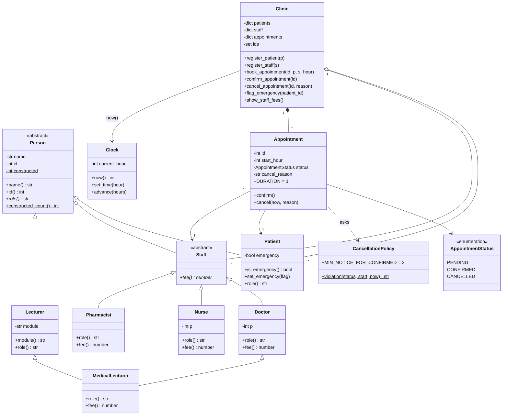
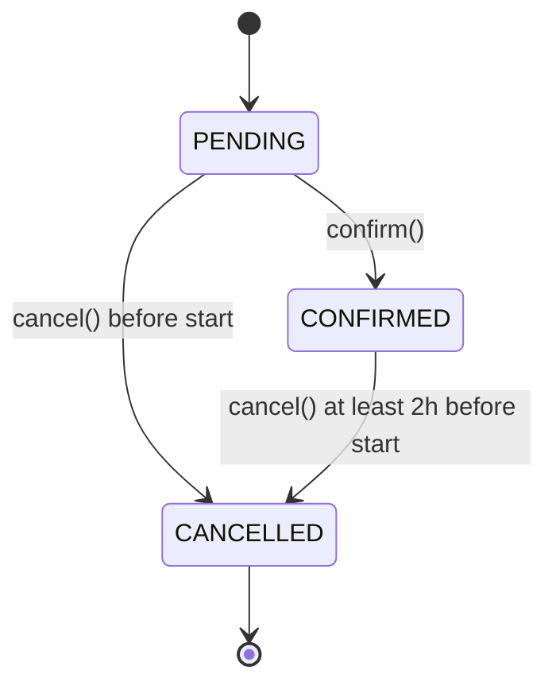

# Clinic Appointment Management System

## Project Information

| Field | Details |
|---|---|
| Project Title | Clinic Appointment Management System |
| Course / Module | HCS301 - 2026 |
| Programming Language | Python 3 |
| Project Type | Pair Assignment |


### Project Team

| Student Name | Student ID |
|---|---|
| Kudakwashe Chikumbu | R2420379 |
| Tawanda Jecheche | R2534853 |

---

## 1. Project Overview

The **Clinic Appointment Management System** is a Python-based application designed to manage patient appointments, healthcare staff, and scheduling operations within a clinic.

Time is a whole number of hours from 0 to 168. Every appointment lasts one hour. No code reads the system clock; everything asks a `Clock` object.

**Twist implemented:** P mod 4 = 1, **Emergency** 

## 2. How to run

Requires Python 3.10+. No third-party packages.

```
python main.py                               
python -m unittest discover -s tests -t . 
```

## 3. Class diagram



### Appointment status transitions



## 4. Answers

### Q2. Encapsulation, status rules, constructors

- **Hidden fields.** Every field is private (`self.__name`) and exposed only through read-only `@property` accessors. Trying to assign `patient.name = "x"` raises `AttributeError`.
- **No leaked lists.** `Clinic` keeps its patients, staff and appointments in private dicts. The public `appointments`, `patients` and `staff` properties return a new `tuple`, so callers cannot add or remove anything.
- **Status changes.** Only `Appointment.confirm()` and `Appointment.cancel()` change status, both via one private method that checks a table of legal moves:
  - PENDING → CONFIRMED
  - PENDING → CANCELLED
  - CONFIRMED → CANCELLED
  - CANCELLED → nothing .
- **Cancellation rules** (in `CancellationPolicy.violation`):
  - already cancelled: refused
  - `now >= start_hour`: refused ("already started")
  - CONFIRMED and fewer than 2 hours' notice: refused ("too late")
- **Constructors.** `require_text` rejects non-strings and empty/blank names; `require_positive_int` rejects `bool`, non-integers and ids of 0 or below. Invalid input raises before the object exists.
- **Invariants** are written as comments above `Person`, `Staff`, `Appointment` and `Clinic`.

### Q3. Fees without type checks

Each subclass overrides `role()` and `fee()`: Doctor `40 + 5 * (P % 5)`, Nurse `10 + (P % 3)`, Pharmacist `5`. `Clinic.show_staff_fees()` is one loop that calls `member.role()` and `member.fee()`; Python picks the right override at run time (polymorphism). There is no `isinstance`, `type()` or type tag in the domain code. A new `Staff` subclass works without editing the loop or `Clinic`; the test `test_new_staff_type_needs_no_clinic_change` defines a `Dentist` inside the test to prove it.

### Q4. The log

Every public `Clinic` action runs inside a **context manager** (`@contextmanager` used with `with`), which is `try / except / finally` in one reusable place:

- the file is opened and `[log] opened` is printed;
- if the action raises, the `except` branch writes `FAILED <action>: <reason>` (for example `FAILED cancel #301: too late`) and re-raises;
- the `finally` branch always closes the file and prints `[log] closed`, even after an error. 

So the log is opened and closed exactly once per action. A nested step (a bump inside a booking) reuses the same open log instead of opening a second one.

### Q5. Lecturer and MedicalLecturer

- `Lecturer(Person)` adds a module name. `MedicalLecturer(Doctor, Lecturer)` inherits from both.
- **One Person.** The method resolution order is `MedicalLecturer, Doctor, Staff, Lecturer, Person`, so `Person` appears once. Every `__init__` takes `**kwargs` and calls `super().__init__(...)`, so each constructor runs once, including `Person`'s.
- **Counter.** `Person.constructed_count()` goes up by exactly 1 when one `MedicalLecturer` is built (shown in `main.py` and tested).
- `role()` returns `"Doctor and Lecturer"`.
- **`fee()`** returns the doctor's fee, `Doctor.fee(self)`. The fee is what the clinic bills for a clinical consultation; lecturing is not billed and `Lecturer` has no fee.
- **Java.** Java has no multiple class inheritance, so `Lecturer` becomes an interface (module name accessor, plus a default `role()` if needed). `MedicalLecturer extends Doctor implements Lecturer` and keeps its own module field. `Person` then has a single base class and its constructor runs once.

### Q6. Rules between objects and the twist

- No staff member and no patient can have two non-cancelled appointments at the same hour. Cancelled slots can be rebooked.
- Ids are unique across patients, staff and appointments (one shared id set).
- Booking an unregistered person, or in the past or at the current hour, is refused.
- A failed booking changes nothing and is logged as `FAILED book #<id>: <reason>`.
- **Twist (Emergency).** A patient can be flagged emergency (`flag_emergency`). Such a patient booking an hour the staff member already holds with a **PENDING** appointment bumps it: that appointment is cancelled with reason `"bumped"` and the new one is created. A **CONFIRMED** appointment is never bumped. All checks happen before anything is cancelled, so a failed emergency booking bumps nobody. The patient's own double-booking is never overridden.

## 5. Design decision log

**D1. Where does the 2-hour rule live?**
In a separate `CancellationPolicy` object, called only from `Appointment.cancel()`. The appointment owns its state, so the rule cannot be bypassed, and the number and the messages are in one place. Alternatives: only inside `Appointment` (cannot be bypassed, but the rule is buried in the entity); in `Clinic` (anyone calling `Appointment.cancel()` directly would skip it); in `Staff` (staff do not know appointment state). Trade-off: one extra small class in exchange for a single source of truth.

**D2. Why is the clock testable?**
`Clock` is passed into `Clinic`, and time only moves when we call `set_time` or `advance`. Tests can put the clock at exactly 8, 9 or 10 and check the 2-hour boundary. Calling the system time directly would make "cancel exactly 2 hours before start" and "after start" untestable, and tests would depend on when they run.

**D3. Adding Pharmacist: what else changed?**
Nothing except the new class and the lines that create and register one. `Clinic` and the fee loop were not edited. (In the earlier version, `Clinic` used `isinstance(staff, Staff)`; that was a leak of type knowledge, and it was removed.)

**D4. MedicalLecturer fee and Person created once.**
`fee()` returns the doctor's fee (see Q5). Python's method resolution order (C3 linearisation) together with cooperative `super().__init__(**kwargs)` stops `Person` being created twice. Without it, calling `Doctor.__init__` and `Lecturer.__init__` explicitly would run `Person.__init__` twice: the counter would read 2 and the second run would overwrite the first one's fields.

**D5. What if writing or closing the log fails?**
- If the log **cannot be opened**, the action is refused with `LogUnavailable` before anything changes. A clinic with no audit trail should not act.
- If a **write or close fails** after the action, a warning goes to stderr and the result stands. Undoing a real booking because the disk hiccuped would be worse.
- A logging failure never hides the original error.

**D6. Twist questions (Emergency, P mod 4 = 1).**
- **(1) Why can't a confirmed appointment be bumped?** A confirmed appointment is a commitment both sides agreed to; PENDING is only a tentative hold. Bumping a confirmed one would break that commitment.
- For the other twists (not implemented here): (0) the waiting list belongs to `Clinic`, because only it sees every appointment and cancellation; (2) `bufferHours()` is asked of the staff object, because a type check would force editing `Clinic` for every new staff type; (3) the discount rate lives in the patient type and `Appointment.price()` combines it with the staff fee, so `Clinic` never checks types.

## 6. Tests

`tests/test_clinic.py` has 37 tests covering: name and id validation, fee formulas, the polymorphic fee loop with a new staff type, status transitions and cancellation boundaries, the clock, double-booking rules, id uniqueness, encapsulation, log open/close/FAILED lines and an unopenable log, the emergency twist, and the MedicalLecturer constructor counter and fee.

## 7. Project layout

```
main.py                      5-minute demo
src/core/                    Clinic, Clock
src/models/                  Person, Patient, Staff, Doctor, Nurse, Pharmacist,
                             Lecturer, MedicalLecturer, Appointment, status enum
src/policies/                CancellationPolicy
src/errors.py                exception types
src/validation.py            shared input checks
tests/                       unit tests
logs/                        clinic.log is written here
```


